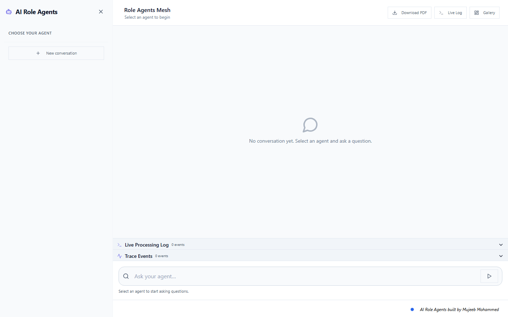
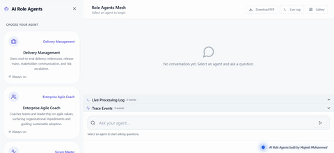
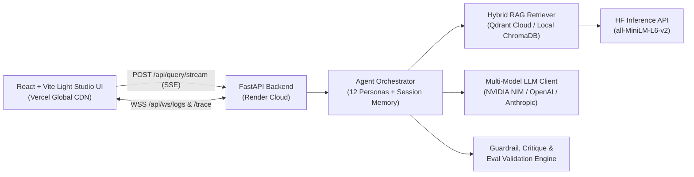

<div align="center">

# AI Role Agents

**An Enterprise Multi-Agent AI Advisory Platform with Grounded RAG, Real-Time Glass-Box Observability, Automated Evals, and Interactive Workflow Diagrams**

[](https://ai-role-agents.vercel.app)
[](https://onrender.com)
[](https://qdrant.io)
[](LICENSE)

Built by **Mujeeb Mohammed** • [Try the Live Platform](https://ai-role-agents.vercel.app) • [GitHub Repository](https://github.com)

</div>

---

## Live Portal Snapshot & Narrated Walkthrough Video

<div align="center">
  
</div>

<br /><br />

<div align="center">
  <a href="docs/media/ai-role-agents-demo.mp4">
    
  </a>
  <p><b>Watch the full AI-narrated walkthrough:</b>
    <a href="docs/media/ai-role-agents-demo.mp4">ai-role-agents-demo.mp4</a> (≈1 min 12 s, edge-tts voiceover)
  </p>
</div>

<br />

<div align="center">

| Chapter | Time | Scene |
|:--------|-----:|:------|
| Scene 1 — Portal Overview & 12 Specialist Role Agents | 0:00 | Light Studio gallery, top-bar controls |
| Scene 2 — Enterprise Agile Coach: end-to-end workflow | 0:19 | Healthcare Digital Transformation pilot, SSE streaming, Trace Events & Live Log |
| Scene 3 — Mermaid diagrams & Eval 90+ guardrails | 0:37 | Zoom controls, quality badge, Context drawer, official videos |
| Scene 4 — Vector PDF export & session protection | 0:53 | Download PDF export, save-before-switch confirmation |

</div>

The narrated walkthrough tours the live AI Role Agents portal — the 12 Specialist Role Agents gallery, the top-bar **Download PDF**, **Live Log**, and **Trace Events** drawers — and runs an end-to-end workflow using the **Enterprise Agile Coach** agent with the prompt *"Design a 2-week Healthcare Digital Transformation pilot sprint plan with workflows and metrics"*. It captures real-time SSE token streaming, multi-source RAG context retrieval, interactive Mermaid workflow-diagram zooming, the `Eval 90+ (valid)` quality badge, and a branded vector PDF export.

---

## Why AI Role Agents?

Generic AI assistants rely on one-size-fits-all system prompts that lack domain boundaries, verifiable citations, or quality controls. **AI Role Agents** solves this by orchestrating **12 specialized enterprise personas**—each grounded in **19,712 indexed domain knowledge chunks**, governed by automated guardrails and self-critique evaluations, and streamed live with full event-level telemetry.

> **Live Production Deployment:** Experience all 12 specialist agents instantly at **[ai-role-agents.vercel.app](https://ai-role-agents.vercel.app)**.

---

## The 12 Domain-Specialist Agents

| Domain Pillar | Specialist Role Agent | Core Accountability & Focus Areas |
| :--- | :--- | :--- |
| **Delivery & Strategy** | **Delivery Management** | End-to-end delivery roadmaps, milestone governance, dependency & risk mitigation |
| **Delivery & Strategy** | **Programme Manager** | Multi-workstream alignment, executive reporting, benefits realization |
| **Delivery & Strategy** | **Management Consultant** | Operating model design, strategic transformation, executive advisory |
| **Agile & Scrum** | **Enterprise Agile Coach** | Scaled agile adoption, organizational agility, leadership coaching |
| **Agile & Scrum** | **Scrum Master** | Sprint ceremonies, empirical flow, team self-organization, impediment removal |
| **Product & Discovery** | **Product Manager** | Product vision, outcome metrics, go-to-market strategy, prioritization |
| **Product & Discovery** | **Product Owner** | Backlog refinement, user story slicing, value maximization, acceptance criteria |
| **Product & Discovery** | **Business Analyst** | Requirements engineering, process modelling, gap & impact analysis |
| **Product & Discovery** | **User Research** | Discovery interviews, usability synthesis, evidence-based user insights |
| **Cloud & Platform** | **DevOps Engineer** | CI/CD pipelines, infrastructure-as-code, release automation |
| **Cloud & Platform** | **Site Reliability Engineer (SRE)** | SLIs/SLOs, error budgets, incident response, chaos & resilience engineering |
| **Cloud & Platform** | **Platform Engineering** | Internal developer platforms (IDPs), golden paths, developer experience |

---

## Key Platform Capabilities

- **Multi-Source Production RAG & Pre-Generation Context Evaluation:** Combines **Qdrant Cloud** (`19,712+` 384-dim vectors + FastEmbed `all-MiniLM-L6-v2`) / local **ChromaDB**, live **OpenAlex** peer-reviewed academic journals, authoritative organizational articles, and **oEmbed + `playableInEmbed:true` verified Official Organizational Videos** (Scrum.org, Scaled Agile/SAFe, CNCF, USENIX, IIBA, Nielsen Norman Group, Atlassian, Google Cloud Tech, NVIDIA, GOTO, Microsoft Developer), filtered and ranked by `SelfEvaluator.filter_and_rank_context` before generation.
- **Continuous Completion & `Eval > 87` (`valid`) Quality Gate:** Automated 5-stage evaluation (`relevance`, `grounding`, `completeness`, `formatting`, `role_compliance`), query-keyword analysis, raw citation artifact sanitization, and structured next-step follow-up recommendations.
- **Production-Ready Vector PDF Export & Session Guard:** Top-bar **Download PDF** button (enabled whenever an active agent conversation exists) generating 100% selectable native `jsPDF` + `autoTable` vector PDFs with high-DPI Mermaid diagrams, branded header/footer (`AI Role Agents portal`, `Page X of Y`, *`AI Role Agents built by Mujeeb Mohammed`*), soft `"AI Role Agents"` background watermark, and a confirmation prompt before switching agents or refreshing an active chat.
- **Production-Only Multi-Model Inference Routing:** Real-time **NVIDIA NIM** (`https://integrate.api.nvidia.com/v1` with automatic `/v1/models` live model discovery fallback), **OpenAI-compatible**, and **Anthropic-compatible** routing (synthetic mock fallbacks removed in production).
- **Glass-Box Real-Time Observability:** Server-Sent Events (SSE) progressive token-by-token streaming from FastAPI to the React Light Studio UI, plus Live Processing Log & Trace Events drawers tracking `trace.rag.retrieve`, `trace.agent.thought`, `trace.guardrail.evaluate`, `trace.critique.generate`, and `trace.validation.final`.
- **Interactive Mermaid.js Workflow Diagrams:** Automatic syntax sanitization and rendering of `flowchart`, `sequenceDiagram`, `gantt`, and `stateDiagram` blocks inside a scrollable viewport with `-` / `100%` / `+` / `Reset` zoom controls.
- **Privacy-Safe Citations:** Every response is grounded with numbered context references (`Reference #1`, `Reference #2`) and framework attributions.

---

## Cloud & Local System Architecture



---

## Project Structure

```text
ai-role-agents/
├── backend/
│   ├── agents/                 # BaseAgent, Orchestrator, and 12 specialist role definitions
│   ├── api/                    # FastAPI routes, SSE streaming, WebSocket trace/log bridges, memory
│   ├── config/                 # Environment-driven configuration & evaluation thresholds
│   ├── core/                   # Multi-provider LLM client, hybrid Qdrant/Chroma RAG, guardrails, evaluator, web_research.py
│   ├── main.py                 # FastAPI application entry point
│   ├── requirements.txt        # Full local dependencies (includes ChromaDB & SentenceTransformers)
│   └── requirements-cloud.txt  # Lightweight cloud dependencies (< 80 MB RAM footprint)
├── frontend/
│   ├── src/
│   │   ├── hooks/              # Auto-reconnecting WebSocket hook for live logs & trace events
│   │   ├── services/           # REST & streaming API client, exportChatPdf.js vector PDF export
│   │   ├── utils/              # Markdown + Mermaid sanitizer, zoom toolbar, and log formatters
│   │   └── App.jsx             # Light Studio interface, Agent Gallery, and Conversation Thread
│   └── vite.config.js          # Dev server & non-buffering SSE proxy configuration
├── source-docs/                # Local domain reference documents (excluded from Git)
├── docs/media/                 # portal-snapshot.png, ai-role-agents-demo.mp4, portal-walkthrough.gif
├── Dockerfile                  # Multi-stage production container build
├── start.sh                    # Container startup hydration script
└── README.md
```

---

## Quick Start (Local Development)

### Prerequisites
- **Python 3.11+**
- **Node.js 18+**
- An **NVIDIA NIM**, **OpenAI**, or **Anthropic**-compatible API key (or run with `LLM_PROVIDER=mock` for zero-key testing)

### 1. Configure Environment Variables

```bash
LLM_PROVIDER=nvidia
OPENAI_BASE_URL=https://integrate.api.nvidia.com/v1
OPENAI_API_KEY=your_nvapi_key
LLM_MODEL=nvidia/nemotron-3.5-lightning-30b-a3b

# Optional: Enable Qdrant Cloud RAG in place of local ChromaDB
EMBEDDING_PROVIDER=nvidia_nim
QDRANT_URL=your_qdrant_cluster_url
QDRANT_API_KEY=your_qdrant_api_key
HF_TOKEN=your_huggingface_read_token
```

### 2. Start the Backend (`http://localhost:8000`)

```bash
cd backend
pip install -r requirements.txt
python -X utf8 main.py
```

### 3. Start the Frontend (`http://localhost:5173`)

```bash
cd frontend
npm install
npm run dev
```

Open **`http://localhost:5173`** in your browser to interact with all 12 AI Role Agents.

---

## Extending the Platform

- **Ingest New Domain Knowledge:** Place `.pdf`, `.md`, `.txt`, or `.docx` documents into `source-docs/<role_key>/` and run the ingestion pipeline to index new chunks into ChromaDB or Qdrant Cloud.
- **Register a New Specialist Role Agent:**
  1. Add domain reference files under `source-docs/<new_role_key>/`.
  2. Define the persona's system prompt, boundaries, and metadata in `backend/agents/roles.py`.
  3. Register the icon, accent colour, and display title in `AGENT_META` inside `frontend/src/App.jsx`.

---

## License

MIT License — Copyright (c) 2026 **Mujeeb Mohammed**
