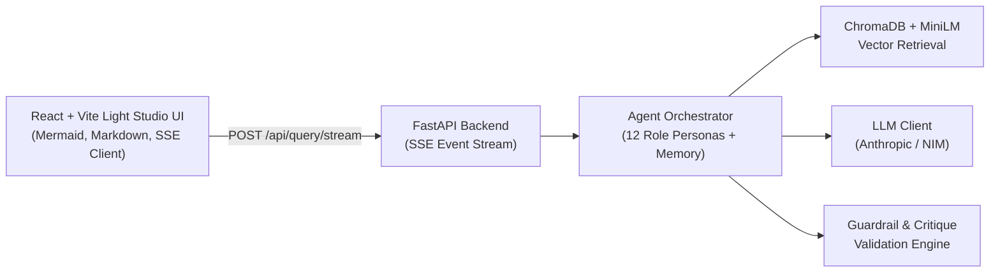

# AI Role Agents

An enterprise multi-agent AI platform featuring **12 domain-specialist role agents**, real-time Server-Sent Events (SSE) token streaming, Retrieval-Augmented Generation (RAG) over local knowledge bases, automated guardrail and response evaluation, and an executive Light Studio React interface.

Built by **Mujeeb Mohammed**.

---

## Key Capabilities

- **12 Specialist Role Agents:** Dedicated system personas and retrieval contexts for *Delivery Management, Enterprise Agile Coach, Scrum Master, Product Manager, Product Owner, Business Analyst, User Research, DevOps Engineer, Site Reliability Engineer (SRE), Platform Engineering, Programme Manager,* and *Management Consultant*.
- **Real-Time SSE Streaming:** Live progressive token streaming with collapsible **Live Processing Log** and **Trace Events** drawers for full observability across RAG retrieval, LLM generation, guardrail checks, and validation scoring.
- **Grounded RAG Knowledge Engine:** Semantic retrieval powered by `SentenceTransformers` (`all-MiniLM-L6-v2`) and `ChromaDB` with numbered, privacy-safe context references (`Reference #1`, `Reference #2`).
- **Rich Visual & Structured Outputs:** Automatic rendering of Markdown tables, bulleted takeaways, citations, embedded media, and interactive **Mermaid.js** workflow diagrams (`flowchart`, `sequenceDiagram`, `gantt`, `stateDiagram`).
- **Flexible LLM Backend:** Supports Anthropic-compatible endpoints (including local proxies via `ANTHROPIC_BASE_URL` and NVIDIA NIM models) as well as deterministic fallback mode.

---

## Architecture Overview



---

## Project Structure

```text
ai-role-agents/
├── backend/
│   ├── agents/          # BaseAgent, Orchestrator, and 12 role definitions
│   ├── api/             # FastAPI routes, SSE streaming endpoint, memory endpoints
│   ├── config/          # Environment-driven settings
│   ├── core/            # LLM client, RAG retriever, guardrails, evaluator, event bus
│   └── main.py          # Uvicorn / FastAPI application entry point
├── frontend/
│   ├── src/             # React components, Markdown + Mermaid renderer, Light Studio CSS
│   └── vite.config.js   # Dev server & non-buffering SSE proxy configuration
├── source-docs/         # Local domain reference documents (excluded from Git)
├── .gitignore
└── README.md
```

---

## Local Quick Start

### Prerequisites
- **Python 3.11+**
- **Node.js 18+**
- An Anthropic-compatible API endpoint or proxy (e.g., local proxy on port `8082`)

### 1. Configure Environment Variables
Set the following environment variables in your system or shell:

```bash
LLM_PROVIDER=anthropic
ANTHROPIC_BASE_URL=http://localhost:8082
ANTHROPIC_API_KEY=your_api_key
LLM_MODEL=claude-sonnet-4-5
```

### 2. Start the Backend (Port 8000)

```bash
cd backend
pip install -r requirements.txt
python -X utf8 main.py
```

### 3. Start the Frontend (Port 5173)

```bash
cd frontend
npm install
npm run dev
```

Open **`http://localhost:5173`** in your browser to interact with all 12 AI Role Agents.

---

## Expanding Knowledge & Adding New Agents

- **Add Knowledge to Existing Agents:** Place new `.pdf`, `.md`, `.txt`, or `.docx` files into `source-docs/<role_name>/` and run your ingestion script to update ChromaDB.
- **Add a New Role Agent:**
  1. Create a folder under `source-docs/<new_role_key>/` with reference documents.
  2. Register the role prompt and metadata in `backend/agents/roles.py`.
  3. Add the role icon and display title to `AGENT_META` in `frontend/src/App.jsx`.

---

## License

MIT License — Copyright (c) 2026 Mujeeb Mohammed
